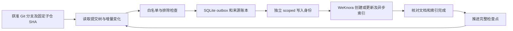

# Git 到 WeKnora 同步实施方案

## 2026-10-09 原生 keyword 双轨 canary 候选（当前）

本轮完成隔离 Windows 服务候选、native keyword 事务写入/持久异步任务/实际 FTS inventory 收据，以及 Python 的 first-add 单库适配。真实 SQLite/FTS 与 Python outbox 的无 socket 合成端到端通过：两个通道共四次写入，丢失首次 POST 回复可查询恢复且无重复提交，整批 completedSHA 关闭重载一致。两个已批准根文档的固定 Git blob 与 Go Unicode15 全表分词核对通过。旧 25 个 guard overlay 已继承；canary 模式关闭历史后台维护/队列恢复、旧 IM 和外部启动连接，使用无迁移 SQLite 检索器。正常模式保留既有行为。

当前真实运行验收未完成：支持的 8081 health / reader metadata / 原服务 Git 入口被权限拒绝，均已停用该检查路径，未绕过。没有创建真实 KB/凭据、访问运行库、部署/备份/短重启、真实导入或调用模型。实际 sources.json 尚不存在，writer/scheduler/系统自启动仍关闭。原 1647 文档/1493 pending 和禁用旧端点保持保护边界。

已批准源为 committed 根 AGENTS.md / AI_CONTEXT.md，local HEAD 与缓存官方 ref 均读到 1b6fd01462bd0ff32a5e05499824a9b72e037d48，official 远端最新仍未知。两个新 KB 的实际 ID 和 Owner 本机配置的独立单库 writer 是剩余外部条件；不再重复要求批准同一范围。首轮只有四个 frozen add、禁止 DELETE/stock write/模型处理/调度。native 试验协议不支持直接启用 schedule 或自动跟踪新提交。

交付见 [Owner 本机操作与验收](service-candidate/Owner-Canary-Handoff.md)、[构建脚本](service-candidate/Build-Canary.ps1)、[Companion 协议](protocol-v1.json) 和 tests/native-canary-evidence-20261009.json。ready=writerReady（实时能力探测），queued=queuedCount>0（只数 queued），indexed 要求完整目标 checkpoint、pending=0、非空活跃映射每条有非合成有效收据；合成 receipts 不计入 indexedDocuments。字段为 v1 的兼容增量。

新功能日志已同步；VERSION 保持 Owner 已批准 0.1.0.1。原34个 staged内容保持，子仓库仍未出生 HEAD；正常 hook 提交曾因系统权限失败，本轮未重试、绕过、push/tag 或改父 pin。候选 ZIP 与 SHA256 receipt 是文件检查点，不能称作已提交 Git 检查点。

以下日期同日的旧切片记录为历史证据，当前 native 边界及阻塞以本节/最新 handoff 为准。

## 2026-10-09 最小 SQLite keyword 原生接入切片

离线实现已落在 `sqlite_keyword_observer.py`；只观察显式库路径，不安装服务、不读取凭据，也不复用被拒的运行DB。合成 producer 在 `tests/test_sqlite_keyword_observer.py`，执行 `tests/sqlite_keyword_receipts.sql` 后把真实 FTS 写入与 generation 成功回执原子提交；实际 provider 接 `IndexVerifier`/`RestAdapter`/`Worker` 可推进合成整批 `completedSHA`。生产标志固定关闭。限定最多128条活动chunk/索引、512条历代rowid/receipt及代码声明的 canary 字符集；向量、FAQ、生成问题等派生 source 不纳入本切片。

固定源码 `D:/services/weknora/build/upstream-v0.8.2`（`3e8b0bfc80b845b2d4b2ed683994748741450a97`）中 SQLite `Save/BatchSave` 先写 `lite_embeddings`，再分别写 FTS/vec；`syncFTS5Insert` 的 SQL 错误被忽略，删除辅助也忽略 FTS/vec 错误。Lite `SyncTaskExecutor` 成功仅日志返回；knowledge 删除跨多个阶段且非单一事务。stock API/SQLite 状态不能单独证明完成。

后续申请的原生源码与部署边界仅为：

1. `internal/application/repository/retriever/sqlite/repository.go`：在专用 keyword-only canary 路径上传播所有 Find/FTS写删/metadata错误；同一 SQLite connection/transaction 更新索引及完成回执。禁止通过构造 retriever 偷做建表或旧FTS重建。
2. 新 SQLite 迁移：只增 `sync_keyword_receipts`、其 ownership index 与 `lite_embeddings_fts_vocab(instance)`，SQL候选已在合成库执行；不改旧表/数据，不恢复旧队列。回执保留完整 operation binding、document generation、source/chunk/revision/input/postings hashes 和历代rowid，删除保留 tombstone。
3. `knowledge_process.go`、`knowledge_delete.go`、`router/sync_task.go` 的 canary 分支：关联本机 outbox operation ID 与确切 native task ID，generation fencing；成功marker只在实际索引核验并提交后写入。入口需把 operation ID传给服务，不能从现有 source metadata 猜测。接收前记录意图；重启只恢复本次受控 canary intent，禁止扫/复跑1493历史pending。
4. 复用现有服务/只读 SQLite 观察模式。若当前DB访问边界保持，由现有服务一个tenant/KB受限只读handler输出 metadata-only证明，CLI不获通用DB权限；不是新增独立服务。实际 route 尚未实现，stock GET metadata observer不升级READY。

部署前须独立批准上述服务源码/build/迁移/restart与rollback窗口，匹配原生 Go tokenizer/SQLite build，建立批准的新空canary库和单库writer，确认keyword路径零模型/外发；首次manual批次完成后才考虑调度。删除实际验收另受maxDeletes授权。验收冻结为创建/更新、错误FTS、旧generation/孤儿、跨scope、崩溃恢复与精确删除：负例不推进checkpoint，全部真实非synthetic回执完成后才推进。没有生产部署或canary批准时，到此离线切片交付，不扩展审计平台。

## 2026-10-09 继续开发：离线可验收实现

后续已按固定官方源码的两条GET路由实现 `OfficialAPIProvider` 离线观察合同；它仅确认文档/分页text chunks元数据的可见状态和一致性，不拥有实际索引inventory或删除task终态API，始终不发READY且不启用production。12项定向观察测试通过；本轮最新完整结果见 `tests/api-observer-evidence-20261009.json`，原77项回执保持历史基线。主线程另转达Owner批准初始版本0.1.0.1，VERSION/版本门已初始化；正常Git Hook集成因当前沙箱MSYS权限拒绝而跳过，checkpoint只按正常合同尝试，不绕过拒绝。该版本批准不覆盖真实source/双库/凭据/处理外发授权。

按主线程最新授权，已实现显式离线cache上的递归父gitlink正文、来源链与固定blob重验。未登记相关mount、缺cache/commit均阻断服务计划；父SHA不变时子HEAD推进不会改变结果，嵌套cache也必须明确登记。删除证明沿目标pin树取得真实存在性，缓存不可用不等于文档删除。

正文不变但出处或处理政策改变也建操作；纯逻辑IndexVerifier校验获批provider、来源/版本、权威chunk计数、每个必需索引的完整ID/hash集合与任务终态。READY收据、mapping、done和整批checkpoint同事务持久化；UNKNOWN阻断不重发，PENDING只读轮询。需要重新publish的更新必须观察到高于上一收据的新版本；metadata-only复用用新操作收据明确绑定旧完整索引收据。账本schema3，旧schema仅拒绝、不自动迁移。

新增27项测试，完整77/77通过（165.224秒），12个Python文件AST检查通过；源码/合成验收见 `tests/development-evidence-20261009.json`。此处“实现”仅指离线逻辑与接口；生产观察provider、真实来源/双轨库/处理外发/删除周期与新writer尚未批准配置，仍未启用生产同步。最小选项见 `owner-options.md`。既有完整50项回执保留为开发前基线；旧服务/reader证据继续只作历史线索。

## 开发前历史回执：2026-10-09（方案仍为 Draft）

同步功能源文件未改，50项完整合成测试结果复用；真实来源仍为空，未真实入队、导入或启动调度。writer/scheduler 保持关闭，生产索引验证器缺失；同步仍不能宣称生产启用。独立仓仍无提交、版本或 remote，源清单、双轨目标库、writer凭据、内容处理/外发边界、删除阈值及运行周期仍待 Owner 决策。

为恢复只读检索而部署的替代 reader 为 ID3 `shidai3-cli-pilot-retrieve-recovery-20261008`，范围为 tenant1、单库 `shidai3-pilot`（`da1051a5-3fff-4198-ba55-017ea79df9c3`）、retrieve-only、full access 关闭，到期 `2026-11-08T01:25:46.685460Z`。新凭据以 hash 存库、以本机 DPAPI 保护；旧 ID1/ID2 元数据和旧密文保留。官方 CLI 已完成真实身份匹配、3条 keyword no-vector 检索，并确认 key-management 与 foreign-tenant KB 请求均为403。Edge 原 Owner 登录下 API key 列表可加载；ID1 标 unavailable、ID3 标本机交接且两者均禁网页复制，ID2 仍可读但未复制。证据见部署目录 `D:/services/weknora/pilot-access/reader-recovery-20261008/`、CLI 回执 `D:/services/weknora/cli/evidence/pilot-readonly-smoke-metadata.json` 和 `reader-boundary-metadata.json`。

最终部署后数据库 guard 已于 `2026-10-09T01:48:05Z` 完成：quick_check=ok、schema dirty=0，documents/chunks/FTS 为 1647/59428/2269，auth_tokens=30、users=2、tenants=2；completed/finalizing/processing 为 154/356/1137，知识状态指纹与基线一致；触发器为空、临时 KB 为0、精确 legacy MCP 端点仍禁用。旧 ID1/ID2 非敏感元数据与原值一致，新 ID3 为双 scope BLOB 且明文 `api_key` 列为空。Companion 官方 client status 确认 `32180` daemon 正在运行，3个 ready Creator 连接及其进程保留，未操作 Creator。知识库 UI 显示官方 CLI 可用、认证未配置，真实关键词查询待执行。部署被产物核对阻塞：269项部署文件中45项与上一轮验收清单不同（涉及 daemon、coordination、HTTP、lifecycle、bridge 与 Web），归属及匹配验证未知；未停 daemon、未覆盖 Companion 产物/源码、未将 reader 传入 Companion。3个未应用原型已移至 `stage evidence/companion-unapplied`，暂不部署。此前批准的短暂停用授权仍有效，当前阻塞为产物不匹配；因此不能宣称 Companion 检索完成。未将建议库创建为事实，也未恢复历史 processing 任务。本轮未改变同步代码、入队合同或生产写入边界。

状态: Draft

日期: 2026-10-06

阶段状态（Owner最新要求）：优先交接官方 CLI，并闭合同步代码最后修补的模拟验收，不扩大功能。37条同步定向合成/mock测试通过；取消竞态、未应用结果恢复后的取消终态及常驻审批缓存已修补并通过只读复审。完整模块结果见 `validation-evidence.json`。真实 sources/写入凭据未登记，生产索引验证器未接入，writer/scheduler/network 均未启用；不声明本方案已完成。当前可执行桥接合同以 `protocol-v1.json` 和 `companion_api.py` 为准，`sync-once` 仅持久化入队。正式提交仍缺 Owner 指定前三段版本，未提交或推送。

Owner: shidai3 工作区 Owner

适用来源: 当前工作区 Accepted 规则及本机官方 WeKnora v0.8.2 固定源码。本文等待 Owner 确认后才作为实施输入。

## 1. 目标与当前状态

任何作者将获准文档提交后，开发通道使用本地提交树；提交进入获准远端正式分支后，正式通道再使用其提交树。两个通道使用独立目标库与来源映射，不合并检索结果；并非只有 Codex 写入的内容才更新。未提交工作文件、未审定笔记、秘密和无关项目不自动导入。

当前没有可靠的 Git → WeKnora 连续同步链。根仓 `.githooks` 维护版本、署名及 Git LFS；`P7000` 的 Git 同步维护 Obsidian 源文件；`codex-lan-sync` 同步有限的 Codex 配置；`codex-migration` 支持一次性迁移。它们不能代替知识索引增量同步。

当前正常试用服务为 `127.0.0.1:8081`，数据为 `D:\knowledge-data\weknora\pilot-access\weknora.db`。旧 `shidai3-pilot` 中有历史资料与 1,493 个 processing/finalizing 状态，不应为了新同步而直接恢复这些历史任务。目录、服务和库的现状见部署证据；本方案不修改它们。

## 2. 工程、数据与权限

| 项目 | 建议位置或范围 | 本轮状态 |
|---|---|---|
| 同步方案及独立工具代码 | `D:\code\shidai3\P8000\knowledge-sync` | dry-run、自动写库与时间调度代码及mock验证获准；真实启用仍待精确确认，remote 和初始版本待定 |
| 复用服务及原生 MCP | `D:\services\weknora` | 已存在；同步不增加第二个 MCP 服务 |
| 同步账本、outbox、提交缓存 | `D:\knowledge-data\weknora\knowledge-sync` | 建议路径，未创建 |
| 账本和同步状态备份 | `D:\knowledge-backups\weknora\knowledge-sync` | 建议路径，未创建 |
| 业务检索数据 | 单独 shidai3 知识库 | 目标库待确认 |
| 个人资料 | 独立个人库及独立源清单 | 不包含在当前 Agent 授权中 |

建议最小技术栈为 Python 3.12 标准库、Git CLI、SQLite 账本及现有 WeKnora HTTP API。先做按需 CLI，再决定定时运行。实施前核实已装 Python 版本；本方案不安装运行时。

代码使用独立 Git 仓库，由父仓未来只记录已验证 gitlink。Owner 已进一步批准无凭据、无外发、无知识库写入的 dry-run：本目录已初始化独立本地仓，尚无 commit、remote、初始版本和父仓登记。不得改动 P1060、ant-cook、Creator、Companion 或他人工作目录。

Owner 已批准 tenant 1、仅 pilot、retrieve-only、30天 REST key。本轮由 Agent 发行仅存 hash 的替代 ID3，并以本机 DPAPI 保护文件接入官方 CLI；真实身份与 keyword `--no-vector --limit 3` 检索已验收。旧 MCP 精确端点现已禁用，原9工具记录保留；未配置新的4工具 endpoint。同步器另用单库 scoped API key，最低所需为 ingest；用于对账的 retrieve 能力按需单独明确。不得复用管理员登录态、Agent 只读 token 或 full-access key。原生 ingest 能力可能同时包含更新和删除，不应称为“只能创建”；工具本身必须限制只能处理其拥有的映射条目。

推荐将新同步写入新的 `shidai3-live` 库，以隔离历史导入及未完成任务。此库尚未创建，也不在当前只读 Agent 授权内。若 Owner 选择继续写入 pilot，需先限定受同步器管理的来源集合，禁止重写或删除历史资料。

## 3. 来源和内容清单

每个来源显式登记稳定 `repo_id`、Git remote、本地提交缓存、获准分支、获准目录、扩展名、目标 tenant/KB 和排除项。初始只处理获准的 Accepted Markdown 文档、接口合同及更新日志。P7000 中没有状态字段的知识条目须由 Owner 明确批准路径，不能默认为正式输入。

禁止导入 `.env`、密钥及凭据、认证配置、`.git`、日志、原始会话 sessions、临时文件、生成产物、二进制与大资源、Deprecated/archive 内容和个人库资料。默认不全量导入源代码。代码事实通过实时 `git`、`rg`、LSP 或代码工具查找；RAG 用于获准文档和经验，不承诺自动降低 token 消耗。

读取 `git ls-tree` / `git show <SHA>:<path>` 的已提交内容，保留 Git 相对路径大小写。校验路径，拒绝绝对路径、`..`、符号链接与跨库跳转，不递归读取 gitlink 指向的任意本地目录。

父仓与子模块默认采用“父仓固定版本”：记录父仓 commit 和每个 gitlink 的精确子仓 commit，再读取对应子树。不得混用父仓固定 SHA 与本地子仓最新 HEAD。缺失子仓 commit 时停止推进检查点。独立跟踪某个子仓正式分支必须另登记为明确来源，并防止同一文档重复入库。

Owner 已选择双通道：`local` 使用本地 HEAD 已提交树供开发检索；`official` 使用获准远端正式引用及父仓精确 gitlink 供正式检索。通道参与 source_key 与目标库身份，开发内容不得混入正式库。未推送的子仓 commit 不进入正式库；即使子仓已经推送，父仓固定模式仍等到 gitlink 更新。未提交文件始终排除。

状态同时显示父仓完成 SHA、父仓目标 SHA、每个固定子仓 SHA，以及可取得的子仓正式分支最新 SHA。子仓正式分支领先 gitlink 时标记“子仓已有交付，父仓尚未纳入”；无法取得最新信息时标记未知并显示最后抓取时间。文档 metadata 保存 parent_commit、source_commit、source_blob_sha 和源路径，Agent 引用的是固定版本，不能把子仓最新文件拼入该快照。

多设备或远程作者的提交由未来独立 Git 缓存抓取获准分支，不能在活跃且可能脏的业务工作树执行 pull/reset。Git 网络访问、认证、抓取周期和缓存目录需要实施授权；不向远程仓发送知识库内容。

## 4. 发现、计划、写入与收敛

可靠性以周期性提交对账为基础，覆盖任何作者、其他电脑、离线提交和漏掉的 Hook。可选 post-commit/post-merge Hook 只投递轻量事件，不能执行远程索引、阻塞提交或替换既有版本/署名/LFS Hook；本轮不安装 Hook。

作者电脑无需注册同步器：只要提交进入获准远端分支，周期抓取和全树对账就能发现。尚未推送、提交在未获准分支、远程不可达或未获得 Git 访问权限的变化不会被假装同步；状态必须展示相应滞后。跳过 Hook 只影响发现速度，不影响周期对账后的最终收敛。

账本至少保存 `(channel, repo_id, path) → knowledge_id`、源 commit/blob SHA、内容摘要、目标 tenant/KB、来源所有权、待处理动作、远端任务 ID 和完整检查点。source_key 用通道、稳定仓库 ID 加 Git 路径构成，记录到 custom_metadata；标题只是显示字段，不能作为主键。

显示标题使用文档一级标题，缺少时用文件名，并附仓库/相对路径以区分同名文档；保留原文和来源链接。修改标题不新建条目，rename 更新显示路径及 source_key 映射。来源 SHA 与正文同一次动作核对，异步索引完成前不得宣称该 SHA 已完成发布。

动作先持久化到 outbox，再发请求。单个目标库持有本地租约，同一来源条目串行执行；按获准分支的提交图和最终树收敛，不按作者电脑时钟排序。可以合并尚未写入的连续变化，但不能跳过正在进行或失败的远端操作。

| 变化 | 行为 |
|---|---|
| 新增 | 首次建立稳定映射，发布后等待索引完成 |
| 内容修改 | 相同 blob/content 摘要跳过；变化则更新原映射条目并等待重建完成 |
| 重命名 | Git 可确认的 rename 更新来源路径，尽量保留 knowledge_id；歧义先对账 |
| 删除 | 仅删除同库、来源所有权与映射一致的条目，保留 tombstone，等待删除任务完成 |
| Git revert | 将新 revert commit 的目标树作为一次正向同步，不能只回退游标 |
| 超时或进程中断 | 恢复 outbox；先按 source_key/hash 对账未知结果，再决定重试 |

这是至少一次执行后的最终收敛，原生 API 没有跨文档事务或 exactly-once 保证。批次部分完成时检索结果可能包含不同源版本；只在该批全部索引/删除确认完成后推进完整检查点。需要原子发布时，应另设计暂存库/代际切换，不能在本工具首版默许。

## 5. v0.8.2 原生 API 的约束

源码固定于 `D:\services\weknora\build\upstream-v0.8.2`，commit `3e8b0bfc80b845b2d4b2ed683994748741450a97`。

- `POST /api/v1/knowledge-bases/:id/knowledge/file` 按文件 hash 去重，不是按源路径 upsert。重复 hash 会返回 DuplicateFileError 并调整已有项 created_at；改了内容则可能创建新的 knowledge_id。不能以反复上传文件代替同步。
- Markdown 首版建议使用 `POST /api/v1/knowledge-bases/:id/knowledge/manual`，后续用 `PUT /api/v1/knowledge/manual/:id` 更新同一 ID；publish 会进入待处理/重建流程。manual 的 version 是服务内部版本，不是 Git SHA，也不能视为并发 CAS。
- `PUT /api/v1/knowledge/:id` 主要更新 title/description/custom_metadata，不能据此认为文件正文已更新。
- `DELETE /api/v1/knowledge/:id` 返回异步 task_id，不表示删除已经完成。
- 未发现通用 source revision 条件更新、幂等请求键或批量原子对账合同。POST 超时后不得盲目重发；需查询核对 source_key、映射和内容摘要，歧义状态保留人工处理。

创建正文及来源 metadata 不能假定原子完成：代码先创建 draft，将返回 knowledge_id 持久化，再补写并核对 metadata，最后对同一 ID publish。publish 增加内部版本，未知结果先核对相同 ID/正文/状态，不能盲重放。请求结果未知、同一 source_key 重复或映射与远端冲突时暂停该条，不能自动删除“疑似重复”条目。

查询文档 parse/index 状态及任务终态，确认新版本可检索后才标记完成。完成条件须在合成和 canary 数据中证明；不能仅凭 HTTP 200 或 completed 文本就承诺索引覆盖全部所需块。

证据：`internal/router/routes_knowledge.go:67`；`internal/application/service/knowledge_create.go:79`、`:1028`；`internal/handler/knowledge.go:1365`、`:1922`。行号以此固定 commit 为准。

## 6. 模型处理与资料外发

本轮已完成官方 CLI metadata/count-only 验收：替代 ID3 通过真实身份核验，keyword `--no-vector --limit 3` 返回3条；验收仅记录 metadata/count，正文未进入聊天或模型。未来正文读取按当次任务授权执行。此入口不执行问答、OCR或默认向量查询；不能把普通 REST keyword-search 等同于服务器全局出站封锁或严格 grep 模式。

写入与检索是不同处理链。即使导入纯 Markdown，publish/indexing 也可能触发 embedding、摘要、自动标签、问答、wiki 或其他模型处理；“仅关键词检索”不自动证明导入不会外发。

首版同步推荐明确采用关键词索引，禁用向量及全部模型派生处理，并以网络拦截的合成验收证明。现有启动配置关闭历史任务执行，不能直接开启全部后台任务以完成新同步。若原生流程无法局部安全处理，需要最小原生适配并独立审查，或请 Owner 批准相应模型处理边界。

| 功能 | 本地方式 | 远程方式可能外发 |
|---|---|---|
| Embedding | 本地 embedding 模型接收文档块/查询 | 文档块或检索问题发给所选 provider |
| 问答/摘要/rerank | 本地模型处理检索片段 | 问题、片段、相关上下文发给 provider |
| OCR | 本地 OCR 处理图片/PDF 页面 | 图片、PDF 页面或识别内容发给 OCR provider |
| Codex 读取 MCP | 本地检索与权限控制 | 选中的检索结果进入 Codex 模型上下文 |

尚未指定最终 embedding/问答/OCR provider。本方案不调用模型，不上传资料，也不增加 provider 凭据。

## 7. 恢复、可见性与边界保护

429 遵循 Retry-After；临时错误采用有上限的退避与抖动；401/403 停止写入并要求修复授权；永久解析错误隔离，保持检查点未完成。禁止无限重试、后台静默丢弃和将失败记作无变化。

删除前核对 tenant、KB、映射及 custom_metadata 来源所有权；单批删除超过配置阈值时暂停并展示 dry-run 清单。该阈值由 Owner 在实现前确认。同步器不得 clear 整库，也不得删除未登记历史文档。

状态输出包括获准分支、目标 SHA、已完成 SHA、待处理数量、失败原因及最后成功时间；不打印凭据、正文或个人资料。Agent 可依据文档 metadata 和完成检查点判断新鲜度；缺失或过期时回查 Git，避免把 RAG 当成最新代码事实。

备份同时保存 WeKnora SQLite 一致性快照、文件存储、outbox 和映射账本，并记录对应源 commit。使用 SQLite 在线备份或受控停机快照，不能只复制活动 `.db` 而遗漏 WAL。恢复知识库和账本后先对账再恢复 worker，防止重复创建和误删除。保留源 Git 与来源清单，支持重建和跨 Windows/macOS 迁移；不搬运凭据作为普通备份内容。

## 8. 实施顺序与验收

当前代码包含只读 `knowledge_sync.py`、登记与审批检查、SQLite outbox/映射/租约、Companion 入队桥接、REST分阶段适配、内部 scheduler 和显式 worker。原13项 Git 边界与37项同步/恢复测试之外，本次新增固定父pin递归正文、严格索引证据及定时双轨合成验收，最终完整结果见 `tests/development-evidence-20261009.json`。没有导入真实业务资料、抓取远端、写入真实知识库或启动定时服务。Git commit/blob替换及缺失promisor对象仍离线拒绝；已登记gitlink读取固定SHA，不读子仓HEAD，缺失cache/commit会阻塞；正式引用远端新鲜度未知。删除另核固定目标链真实缺失与映射所有权，不把状态/格式排除当作删除。纯验证逻辑及provider接口已实现，生产观察provider未接入；真实正文处理、索引更新/删除、模型出站和canary验收仍未完成，不能声称上线。

1. Owner 确认来源清单、目标库、处理边界、写入能力与目录/仓库安排。
2. 实现只读 dry-run：比较获准提交树，生成增删改/rename 清单和排除原因，不写 WeKnora。
3. 合成测试：任何作者提交；父子仓固定 SHA；重复请求与未知 POST 结果；断网、429、401、索引失败；rename/delete/revert；任意阶段崩溃恢复；混合大小写/路径穿越；敏感文件排除；模型和网络拦截。
4. 单独批准并配置 writer；在空的 canary 库导入少量无敏感 Markdown，验证正文、metadata、FTS 更新、删除终态及一致性备份恢复。
5. Owner 验收后选择正式目标库和范围；定时运行、Hook 或自动启动另行明确授权，再执行启用和回滚演练。

首版完成标准：任何作者的获准分支提交都能在设定周期内反映到目标知识库；失败时报告滞后与原因；重试/恢复不产生未处理重复条目；删除不越过映射边界；当前检索身份依然只有只读权限；未获准模型处理无外发。

## 9. 实施前需要 Owner 决策

- 源仓库、正式分支与路径白名单；开发/正式双通道已确定，未提交草稿不在本轮范围。
- 继续使用 pilot，还是新建 shidai3-live；个人资料另选独立库与来源，不默认开放给工作区 Agent。
- 采用本地关键词处理，还是批准具体 embedding/问答/OCR provider 及其资料范围。
- 同步 writer 的单库权限与删除阈值；Git 抓取、账本/备份目录、运行周期和是否允许后续自动运行。
- 未来独立工具仓库 remote、初始前三段版本和维护责任。

当前只读 Agent MCP 创建/启用，与未来同步写入审批分别处理；不得以已经批准检索为理由增加写入权限。
